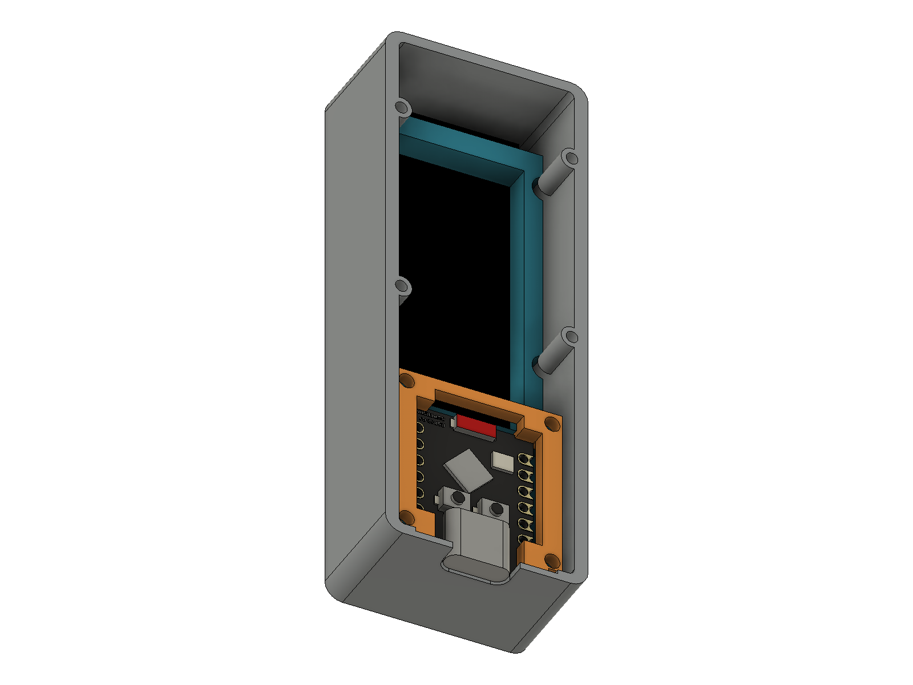
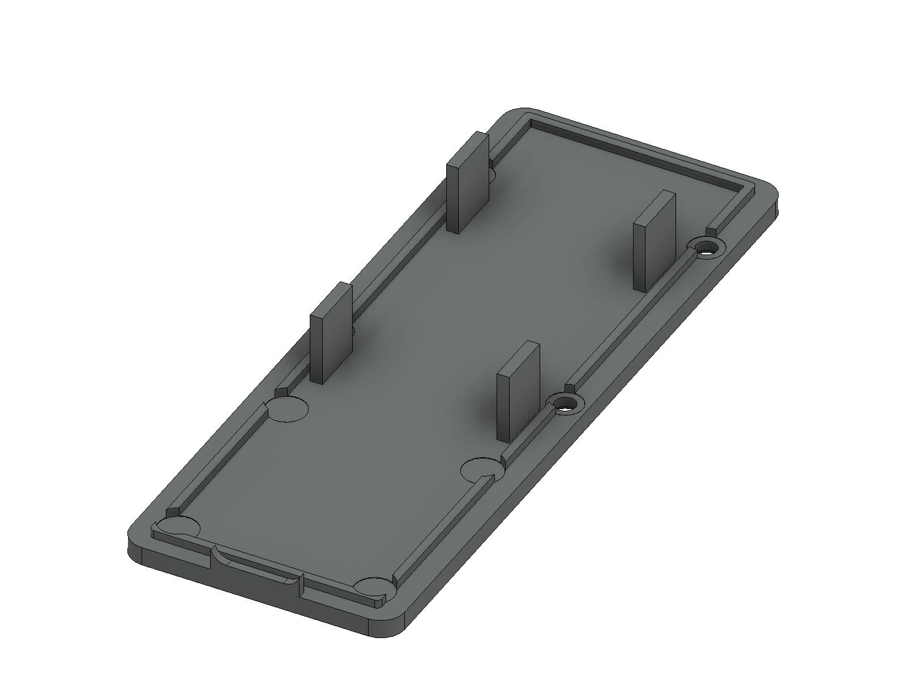

# Case V2 gọn hơn, lắp cụm PCB từ phía sau

Case ngoài: **28,98 × 78,55 × 18,9 mm**. Giảm bề ngang 5 mm so với V1. Thành bên 2 mm.

Mép cửa sổ vát từ mặt vỏ xuống sát màn, có bo R0,35 tại miệng. Cổ cửa sổ cách mặt kính tham chiếu 0,2 mm. PCB màn tựa trực tiếp lên hai gờ dài của khung, khe hở thiết kế bằng 0.

## Cách khung đi qua các trụ vít

Bốn rãnh ở hai cạnh khung chạy qua vị trí trụ nắp. Chúng chừa 0,3 mm quanh trụ, cho cả cụm đi thẳng vào từ mặt sau. Khung được giữ giữa gờ chặn mép PCB phía trước và bốn gờ tỳ trên nắp sau. Bốn vít nắp đóng cụm này lại.

Lỗ USB mở xuống mặt sau khi tháo nắp để đưa cổng vào được. Một phần mép USB nằm trên nắp; khi đóng nắp, miệng hoàn chỉnh có biên dạng **9,6 × 3,8 mm, R1,8**. Mặt cổng kim loại lùi 0,25 mm so với mặt ngoài vỏ.

## Thứ tự lắp

1. Đặt hai ê-cu M2 vào hốc dưới khung. Đặt màn TFT lên các gờ đỡ, bắt hai vít M2 × 6 qua hai lỗ PCB vào ê-cu. PCB áp mặt gờ đỡ; kính LCD không bị khung đè.
2. Đặt ESP lên bốn mặt tựa phía sau, USB hướng về đầu ngắn gần hai lỗ TFT. Đặt nẹp và bắt bốn vít M2 × 6 vào khung. Nẹp giữ các mép PCB ESP.
3. Đấu và thu gọn dây giữa hai board. Đưa cả cụm thẳng vào thân từ phía sau, canh bốn rãnh với các trụ và USB với khe mở ở đầu ngắn.
4. Lắp nắp theo gờ định vị. Bốn gờ cao của nắp tỳ vào mặt sau khung; phần gờ đầu ngắn hoàn thiện mép dưới USB. Bắt bốn vít M2 × 6 qua nắp vào trụ thân.

Dự kiến dùng **10 vít M2 × 6 và hai ê-cu M2**. Nẹp đã chừa hốc trên gờ nắp cho đầu vít. Lỗ mồi trụ Ø1,7 mm cần thử với vít và vật liệu in thực tế.

## Kiểm tra và kích thước tham chiếu

Bốn STL xuất từ Fusion, theo mm; mỗi file là một khối kín liền. Không phát hiện giao thể tích trong bản lắp CAD. Đường đưa cụm vào đã kiểm tra 49 vị trí cách nhau 0,5 mm, có mô hình đầu vít; đường đóng nắp cũng được kiểm tra.

PCB TFT dày 1,6 mm và LCD nhô thêm 1,5 mm đang là giả định, tổng 3,1 mm. Hàng chân TFT phía sau giả định nhô 6 mm. STEP ESP không có các hàng pin đã hàn. Cần đối chiếu màn, dây và mối hàn thực tế trước bản in cuối.
