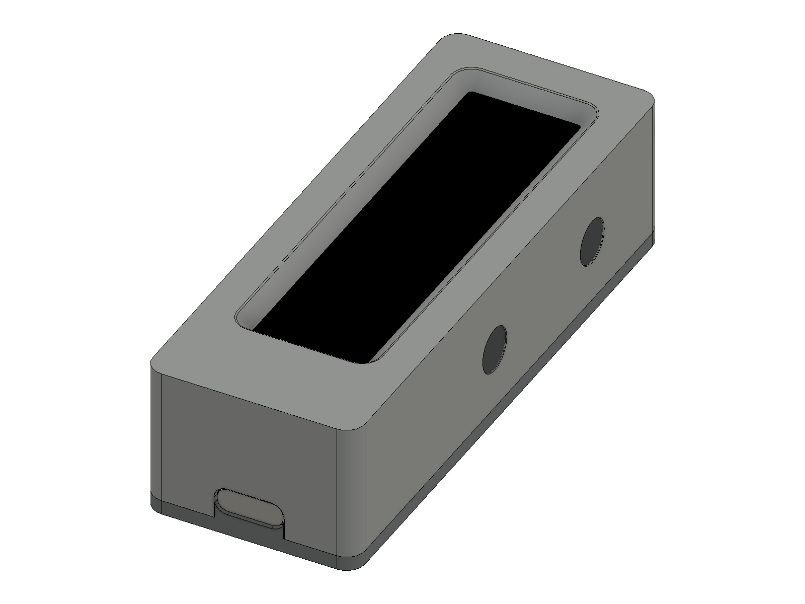
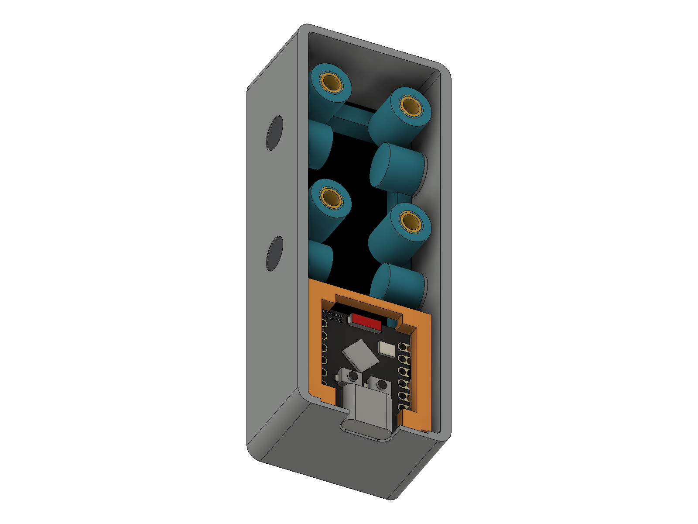
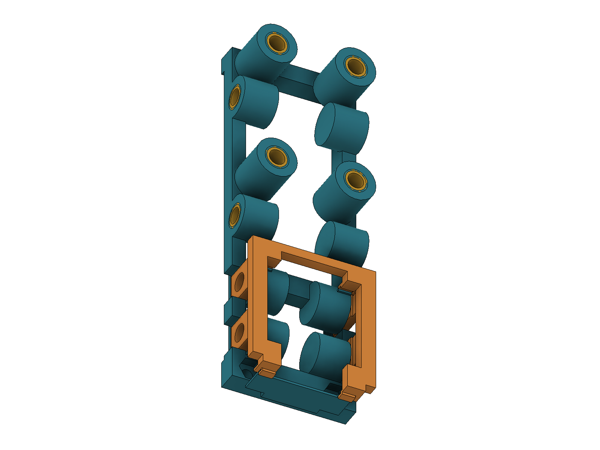

# Khung và case flip clock — bản M3 / ốc cấy

Hai vít giữ TFT vẫn là M2. Mọi vít khác là M3, vặn vào 12 đai ốc đồng cấy nhiệt trong khung. Khung bắt riêng vào thân bằng 4 vít ở hai bên, nên tháo nắp sau thì khung vẫn được giữ cố định.

## Linh kiện

| Vị trí | Vít | Số lượng | Đai ốc |
|---|---|---:|---|
| PCB màn hình → khung | M2 × 6, đầu trụ nhỏ Ø≤3,8 mm | 2 | 2 đai ốc lục giác M2, AF 4 mm, dày ≤1,6 mm |
| Nẹp ESP → khung | M3 × 6, đầu nút ISO 7380, Ø≤5,7 mm | 4 | 4 ốc cấy M3 Ø4,6 × 4 mm |
| Khung → thân | M3 × 8, đầu chìm 90° DIN 7991, Ø≤6 mm | 4 | 4 ốc cấy M3 Ø4,6 × 4 mm |
| Nắp sau → khung | M3 × 6, đầu nút ISO 7380, Ø≤5,7 mm | 4 | 4 ốc cấy M3 Ø4,6 × 4 mm |

Chiều dài vít đầu nút tính từ dưới đầu; vít đầu chìm tính cả đầu. Chọn đúng đầu chìm DIN 7991 Ø6 mm: một số vít ISO 10642 M3 có đầu lớn hơn, không phù hợp hốc này. Không thêm long đen vào các hốc đầu vít đã định chiều sâu.

Ốc cấy đã chốt Ø4,6 × dài 4 mm; ví dụ [ruthex RX-M3Sx4.0](https://www.ruthex.de/en/products/ruthex-gewindeeinsatz-m3s-100stuck-rx-m3x4-0-short-messing-gewindebuchsen-fur-3d-druck). Hốc nhựa Ø4,0 mm, sâu 5,0 mm, có lỗ thoát đầu vít Ø3,4 mm ở đáy. Kích thước đầu nút đối chiếu [M3 × 6 ISO 7380](https://www.accu.co.uk/socket-button-screws/155226-SSB-M3-6-A4-BL); đầu chìm đối chiếu [M3 × 8 DIN 7991](https://www.accu.co.uk/vented-socket-countersunk-screws/419659-SSKV-M3-8-A2-R360).

## Thứ tự lắp

1. Cấy 12 đai ốc vào **01_KHUNG_HA_ESP**, khi chưa lắp điện tử: 4 hốc hai bên dưới khu vực ESP, 4 hốc ngang ở vị trí giữ khung với thân, 4 hốc nhìn từ phía sau ở các trụ giữ nắp. Cấy phẳng mặt hốc rồi để nguội. Kiểm tra vít ăn ren bằng tay trước khi lắp PCB.
2. Đặt 2 đai ốc M2 vào hốc lục giác phía sau đầu khung. Đặt PCB màn hình trực tiếp lên gờ tỳ, bắt 2 vít M2 từ mặt trước. Không siết lên kính LCD.
3. Đặt ESP lên 4 gờ đỡ ở mặt sau, PCB song song với PCB màn hình và USB-C hướng về đầu ngắn có hai vít TFT. Đặt **02_NEP_ESP** ôm các mép PCB; bắt 4 vít đầu nút M3 × 6 từ hai bên, vào 4 ốc cấy của khung. Các gờ giữ PCB không ép vào linh kiện.
4. Hoàn tất dây nối trước khi đưa cụm vào case. Đưa cả cụm TFT + khung + ESP + nẹp thẳng từ mặt sau vào **03_THAN_CASE**; USB-C trượt vào phần khoét hở phía sau. PCB TFT tỳ sát gờ phía trước.
5. Bắt **4 vít đầu chìm M3 × 8 từ hai cạnh dài của thân** vào ốc cấy ngang trên khung. Hai vị trí dọc mỗi cạnh nằm tại 33 và 58 mm tính từ đầu PCB TFT có hai lỗ M2. Mặt tỳ bên trong thân tiếp xúc mặt trụ khung để truyền lực siết. Đây là liên kết cố định khung với thân, độc lập với nắp sau.
6. Đặt **04_NAP_SAU**, phần lưỡi ngắn khép biên dạng dưới của lỗ USB-C. Bắt 4 vít đầu nút M3 × 6 từ phía sau qua hốc chìm trên nắp, vào 4 ốc cấy ở trụ khung. Tháo 4 vít này để mở nắp; 4 vít bên thân tiếp tục giữ khung.

Muốn lấy toàn bộ khung ra thì mở nắp, tháo 4 vít chìm bên thân, rút cụm thẳng về phía sau. Nẹp ESP được lắp trước khi đưa khung vào thân.

## Kích thước và kiểm tra

- Tổng thể: **28,98 × 78,55 × 20,9 mm**, bề ngang giữ nguyên bản V2; chiều sâu tăng 2 mm để đủ chỗ cho các trụ ốc cấy M3 giữa hai PCB.
- PCB TFT 21,08 × 73,15 mm, hai lỗ Ø2,5 mm theo hình người dùng; khe giữa PCB TFT và PCB ESP 8,2 mm.
- PCB TFT đặt trực tiếp trên khung, khe tỳ 0 mm. Miệng cửa sổ có mặt vát thu dần và bo R0,35 mm; cổ cửa sổ cách mặt kính tham chiếu 0,2 mm.
- ESP lấy từ STEP người dùng, 61 khối; USB-C lùi 0,25 mm so với mặt ngoài đầu ngắn. Lỗ USB-C bo góc theo vỏ cổng, 9,6 × 3,8 mm, R1,8 mm.
- Kiểm tra bằng STEP xuất từ hình học Fusion cuối: 4 chi tiết in liền khối, không giao nhau; các bao hình vít không chạm nhựa/PCB; cụm đi vào thân ở 49 vị trí và nắp đi vào ở 25 vị trí không bị chặn. Bốn STL xuất cuối đều kín, mỗi tệp chỉ có một khối; diện tích tỳ khung với thân khoảng 65,6 mm² mỗi bên.

Chiều dày TFT vẫn là giả định PCB 1,6 mm + LCD 1,5 mm và phần chân TFT phía sau 6 mm. STEP ESP không có hàng chân đã hàn hay dây nối. Trước khi in cả bộ, đo lại các phần này và in thử hốc Ø4 mm với loại nhựa/máy in sẽ dùng để kiểm tra cấy Ø4,6 mm.

## Tệp

`deliverables/flip_clock_case_v3_M3_inserts.f3d` chứa cụm lắp và lịch sử sketch/extrude/loft/fillet trong Fusion, cùng các bao hình 12 ốc cấy và 12 vít M3 để kiểm tra khoảng hở. Bao hình kim loại không mô phỏng chi tiết ren hay khía cấy.

Bốn STL trong `deliverables` chỉ chứa chi tiết nhựa, đơn vị mm. Chọn hướng in và support phù hợp các trụ/lỗ ngang; tránh support trong hốc ốc cấy. Các tệp `check_*.step` và `check_*.stl` là hình học kiểm tra độc lập, không phải bản xuất cuối từ Fusion.

